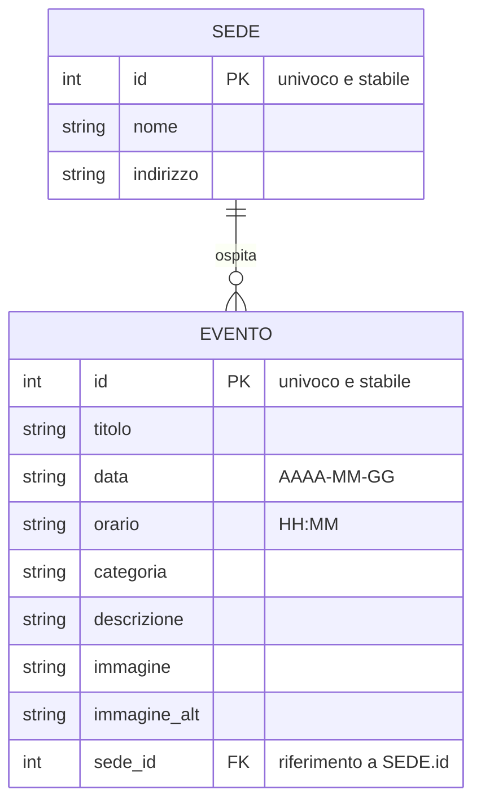

# Scheda dati — Segnale

I dati del festival stanno in due file JSON nella cartella `dati/`: `eventi.json` e `sedi.json`. Ogni file contiene un elenco di record.

## Entità

- **Evento**: un appuntamento del festival (incontro, laboratorio o mostra). File: `dati/eventi.json`.
- **Sede**: un luogo in cui si svolgono gli eventi. File: `dati/sedi.json`.

## Campi di Evento

| Campo | Tipo | Esempio |
| --- | --- | --- |
| `id` | numero intero (chiave primaria) | `1` |
| `titolo` | testo | `"Lettere in movimento"` |
| `data` | testo, data nel formato `AAAA-MM-GG` | `"2026-06-12"` |
| `orario` | testo, ora nel formato `HH:MM` | `"10:00"` |
| `categoria` | testo: `Incontro`, `Laboratorio` o `Mostra` | `"Incontro"` |
| `descrizione` | testo | `"Come cambia un messaggio quando cambiano le lettere? …"` |
| `immagine` | testo, percorso relativo dell'immagine | `"assets/lettere-in-movimento.svg"` |
| `immagine_alt` | testo alternativo dell'immagine | `"Lettere geometriche disposte su una griglia"` |
| `sede_id` | numero intero (chiave esterna verso `Sede.id`) | `1` |

## Campi di Sede

| Campo | Tipo | Esempio |
| --- | --- | --- |
| `id` | numero intero (chiave primaria) | `1` |
| `nome` | testo: nome nel festival — luogo reale | `"Officina Nord — Sede centrale"` |
| `indirizzo` | testo | `"Corso Duca degli Abruzzi 24, Torino"` |

## Chiave primaria

In entrambe le entità la chiave primaria è `id`: un numero univoco all'interno della propria entità e stabile, cioè non cambia quando si modificano gli altri campi. Gli `id` non devono essere consecutivi.

## Relazione

Una sede può ospitare più eventi; ogni evento si svolge in una sola sede. Il campo `Evento.sede_id` fa riferimento a `Sede.id`: nome e indirizzo della sede sono scritti solo in `sedi.json` e ogni evento li richiama tramite `sede_id`.

## Quantità

- 6 eventi (`id` da 1 a 6), tre per ciascuno dei due giorni del festival.
- 3 sedi (`id` da 1 a 3), ognuna con due eventi.

## Chi aggiorna i dati e come

Chi gestisce il sito modifica i file JSON nella repository, con un editor di testo o direttamente su GitHub. Prima di salvare controlla che il JSON sia valido, che ogni `id` sia univoco e che ogni `sede_id` corrisponda a una sede esistente. Poi fa commit e push sul ramo `main`: GitHub Pages pubblica la nuova versione del sito con il percorso già usato.

## Che cosa mostra la pagina

La pagina **Programma** mostra i sei eventi come schede su una griglia (una, due o tre colonne secondo la larghezza dello schermo). Ogni scheda riporta immagine con testo alternativo, giorno e orario, categoria, titolo, descrizione e sede; il nome della sede si ottiene da `sedi.json` attraverso `sede_id`. La pagina **Info e luoghi** mostra le tre sedi con nome e indirizzo.

## Schema Evento–Sede

